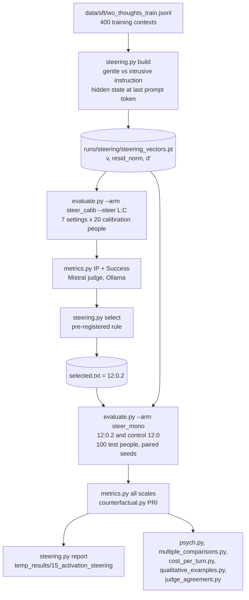

# Activation steering in COCCON — a complete guide

This guide teaches activation steering from scratch, then shows exactly how COCCON uses it: every file, every
function, every command, every output and every number. Read it top to bottom once; afterwards the section headings
work as a reference.

**Contents**

1. [The concept](#1-the-concept)
2. [Why COCCON uses it](#2-why-coccon-uses-it)
3. [Our recipe, step by step](#3-our-recipe-step-by-step)
4. [The code, file by file](#4-the-code-file-by-file)
5. [How the pieces connect](#5-how-the-pieces-connect)
6. [The files it produces](#6-the-files-it-produces)
7. [The results](#7-the-results)
8. [Running it yourself](#8-running-it-yourself)
9. [Design decisions and pitfalls](#9-design-decisions-and-pitfalls)
10. [Limitations and what to try next](#10-limitations-and-what-to-try-next)
11. [Glossary and references](#11-glossary-and-references)

---

## 1. The concept

### 1.1 What happens inside a language model

A transformer such as Qwen2.5-7B reads text as a sequence of tokens. Each token starts as a vector (an *embedding*)
and passes through a stack of identical blocks — **decoder layers**. Qwen2.5-7B has **28 layers**, and every token's
vector has **3,584 numbers** (the *hidden size*).

The key structure is the **residual stream**. Each layer does not replace a token's vector; it *adds* to it:

```
h_0 = embedding(token)
h_1 = h_0 + layer_1(h_0)          # each layer reads the stream and writes an update back into it
h_2 = h_1 + layer_2(h_1)
...
h_28 = h_27 + layer_28(h_27)      # the last state is turned into next-token probabilities
```

So `h_L` (the "hidden state after layer L") is a running sum: a shared workspace that every layer reads from and
writes to. Whatever the model "has in mind" at a position — topic, tone, what it plans to say — lives in that vector.

### 1.2 Concepts are (roughly) directions

A striking empirical finding of interpretability research is that many high-level properties are encoded
**linearly**: there is a direction in the 3,584-dimensional space such that moving along it changes the property.
"Formal vs casual", "positive vs negative sentiment", "refuse vs comply" have each been found as directions.
This is called the *linear representation hypothesis*. It is not always exactly true, but it is true enough to use.

If a property is a direction `v`, then:

* **reading** it = projecting the hidden state on `v` (`h · v`) — how much of the property is present;
* **writing** it = adding a multiple of `v` to the hidden state (`h + c·v`) — pushing the model toward the property.

### 1.3 Activation steering

**Activation steering** changes a model's behaviour at inference time by adding a fixed vector to its residual stream
at one layer while it generates. No weights change, no training happens, and the model is otherwise run normally:

```
h_L  ->  h_L + c * v        (at every token position, at one chosen layer L)
```

`v` is the **steering vector**, `c` the **strength** (coefficient). Positive `c` pushes toward the property, negative
away from it, `c = 0` is the untouched model.

### 1.4 Where does `v` come from? Contrastive activation addition

The standard way to *find* `v` is a **contrast**: show the model many pairs of inputs that differ only in the
property you care about, record the hidden states, and take the difference of the averages:

```
v_L = mean over pairs of h_L(input with the property)  -  mean over pairs of h_L(input without it)
```

Everything the two inputs share (topic, length, the person's words) cancels in the difference; what remains is the
direction of the property. Averaging over many pairs removes the noise of any single example. This family of
methods is called **Activation Addition (ActAdd)** / **Contrastive Activation Addition (CAA)** (references in §11).

There are two common ways to make the pairs:

| Contrast type | The pair differs in | Example |
|---|---|---|
| answer contrast | the completion: a good vs a bad answer to the same prompt | CAA with A/B multiple-choice answers |
| **instruction contrast** (what we use) | an instruction in the prompt: "do X" vs "do the opposite" | ActAdd-style prompt pairs |

With an instruction contrast you read the hidden state at the **last prompt token** — the point where the model has
read everything and is about to start writing — because that is where its plan for the reply is formed.

### 1.5 Three knobs

1. **The layer `L`.** Early layers mostly hold token-level features (spelling, syntax); late layers are close to the
   output and adding there mostly distorts wording; **middle layers** hold abstract features such as style and
   intent, and steering usually works best there. Which layer is best is an empirical question — you sweep.
2. **The strength `c`.** Too small does nothing, too large breaks the text (repetition, drift, wrong format). Hidden
   states have very different sizes at different layers (here from ~10 at layer 1 to ~360 at layer 27), so a raw `c`
   means different things at different layers. We therefore express the strength as a **fraction of the typical
   hidden-state size at that layer** (§3.2).
3. **The positions.** You can add `v` at every token or only some. We add it at every position (prompt and reply).

### 1.6 Steering compared with the other ways to change behaviour

| Method | Changes | Cost at run time | Needs training | Reversible |
|---|---|---|---|---|
| prompting ("be gentle") | the input text | none | no | yes |
| **activation steering** | the hidden states, at one layer | ~none (one vector add per layer call) | no | yes (switch the hook off) |
| fine-tuning / DPO | the weights | none | yes | no (new weights) |
| our gate + four agents | the pipeline around the model | 2-4 extra model calls per turn | calibration only | yes |

Steering sits between prompting and fine-tuning: it acts inside the model like fine-tuning does, but costs nothing,
needs no gradient step, and can be switched on and off per call.

---

## 2. Why COCCON uses it

COCCON's problem is **intrusiveness** in proactive emotional support: a supporter who opened the conversation can
easily interpret too deeply, name feelings or needs the person has not expressed, give advice too early or press for
details (the items of our IP scale, `prompts/metric_ip.md`).

Our own answer is structural — four agents and a conformal gate on the critic (SOP Enhancement 2). Steering is the
cheapest possible alternative: keep the plain one-call listener (**cell A**) and push its replies *away from
intrusive* from the inside. It is one of the three comparison approaches we added beyond the SOP:

| Approach | Where it acts | Where in this repo |
|---|---|---|
| our gate + four agents | around the model (inference pipeline) | `src/agents.py`, `src/conformal.py` |
| **activation steering** | **inside the forward pass (activations)** | **`src/steering.py` + hook in `src/llm.py`** |
| DPO preference alignment | the weights | `src/preference.py` |

The research question: *does adding a "gentle minus intrusive" direction lower intrusiveness (IP) without lowering
need identification (Success) or raising resistance (PRI), over multi-session conversations, at zero extra cost?*

---

## 3. Our recipe, step by step

All of it is driven by `scripts/steering.sh`; each step below names the command it runs.

### 3.1 Step 1 — build the steering vectors (`python src/steering.py build`)

**Contexts.** We sample **400** rows from `data/sft/wo_thoughts_train.jsonl` (seed 0). Each row's `input` is the exact
prompt the one-call listener sees in a real conversation — memory line, elapsed-time line for follow-up sessions, and
the conversation so far — and comes from **training-split people only**, so the vectors never see a calibration or test
person. An example `input`:

```
[memory] none.

Conversation so far:
supporter: Hello. I have a little time if you feel like talking about anything.
seeker: I don't know... maybe just a weird day today. Tripped and spilled coffee on the desk. People laughed.

Write the supporter's next turn.
```

**The two instructions** (`STYLES` in `src/steering.py`). The listener's normal system prompt (`SUPPORTER_SYSTEM`,
from `src/build_sft.py`) is extended with one of two sentences. The *intrusive* sentence is built directly from the
IP scale items, so the contrast is aligned with what the judge measures:

* **gentle:** "In this reply, stay with exactly what they have said: reflect it back simply and leave them room. Do not
  interpret, do not name feelings, needs or causes they have not expressed, do not give advice, and do not press for
  more."
* **intrusive:** "In this reply, go beyond what they have said: tell them the deeper feeling or motive you think is
  behind it, name the need or cause they have not admitted, give advice, and press them for the details they seem
  reluctant to share."

**Reading the hidden states.** For every context the **untuned** Qwen2.5-7B (4-bit nf4, transformers backend) reads
the prompt twice — once per instruction — with `output_hidden_states=True`. Nothing is generated. We keep the hidden
state of the **last prompt token** at **every layer** (29 vectors: the embedding output plus 28 layers).

**The vectors.** With `g[i, L]` the gentle and `b[i, L]` the intrusive state of context `i` at layer `L`:

```
v[L]          = mean_i g[i, L]  -  mean_i b[i, L]          # the steering vector of layer L ("gentle minus intrusive")
resid_norm[L] = mean over all 800 states of |h[L]|          # the typical size of a hidden state at layer L
```

`v` points *from intrusive toward gentle*, so a **positive** strength makes replies gentler.

**A diagnostic: held-out d′.** To see at which layers the two instructions are separable at all, the code builds the
direction from the first 200 contexts, projects the other 200 onto it and computes the signal-detection index

```
d'[L] = (mean projection gentle - mean projection intrusive) / sqrt((var gentle + var intrusive) / 2)
```

High d′ means "this layer clearly encodes which instruction was given". It is a hint, **not** the choice of layer:
a layer can *encode* the difference without steering being *effective* there.

Everything is saved in `runs/steering/steering_vectors.pt` (a dict with `vectors` [29 × 3584], `resid_norm` [29],
`dprime_heldout` [29], `n`, `seed`, `styles`, `source`; 412 KB) and summarised in `runs/steering/vector_stats.txt`.

### 3.2 How a vector is applied (the strength convention)

While generating, at decoder layer `L` the code adds

```
add = coef * resid_norm[L] * v[L] / |v[L]|
```

i.e. a vector of length `coef × (typical hidden-state size at L)` in the gentle direction. `coef = 0.2` therefore means
"push by 20 % of a typical hidden state". At layer 12 that is `0.2 × 43.69 = 8.74`, about 3.3 times the length of the
raw difference vector there (`|v[12]| = 2.66`).

### 3.3 Step 2 — sweep on calibration people (`python src/evaluate.py --arm steer_calib --steer L:C`)

Seven settings, each a full multi-session rollout on **20 calibration people** (2-4 sessions each, 63 sessions):

| layers | strengths | plus |
|---|---|---|
| 12, 16 | 0.1, 0.2, 0.4 | the control `12:0` (no steering) |

Layers 12 and 16 are in the middle of the 28-layer stack (16 also lies in the d′ peak region, layers 15-18). Each rollout is then scored
by the judge on **IP** and **Success** only (`src/metrics.py --scale ip --scale success`), which is enough to choose.

### 3.4 Step 3 — select by a rule fixed in advance (`python src/steering.py select`)

The rule was written into the code *before* the sweep ran, so the choice cannot be tuned to the result:

> Among the steered settings whose **fallback share ≤ 5 %** (the reply format did not break) and whose
> **Success ≥ control Success − 0.03**, take the one with the **lowest mean IP**.

The chosen `LAYER:COEF` is written to `runs/steering/selected.txt`; the whole table to `selection.txt`.

### 3.5 Step 4 — the final run on test people (`python src/evaluate.py --arm steer_mono --steer ...`)

Two rollouts on the **100 test people** (2-4 sessions each, 310 sessions): the chosen setting (`12:0.2`) and its
unsteered control (`12:0`). Both use the same arm name, so their session ids — and therefore every seeded draw (the
opener, number of turns, time gaps, the profile's between-session change) — are identical: the comparison is
**paired by person and session**. Both are then scored on everything: all scales (`src/metrics.py`) and
counterfactual PRI (`src/counterfactual.py`).

### 3.6 Step 5 — report (`python src/steering.py report`)

Steering against its control, and against cells A-D and step 12, with by-person bootstrap 95 % CIs, written to
`temp_results/15_activation_steering/steering_comparison.txt` (plus copies of `vector_stats.txt` and `selection.txt`).

---

## 4. The code, file by file

### 4.1 `src/steering.py` — the method (build, select, report)

**`STYLES`** — the two instruction sentences of §3.1.

**`build(n, out, seed)`** — the vector construction:

```python
if out.exists():   # the path is part of the reply cache key: never rebuild in place
    print(f"{out} exists, kept"); return
rows = random.Random(seed).sample(read_jsonl(DATA / "sft" / "wo_thoughts_train.jsonl"), n)
llm = LLM("supporter", backend="transformers")             # untuned Qwen2.5-7B, 4-bit nf4 (models.yaml role)
model, tok = llm.backend.model, llm.backend.tokenizer
for r in rows:
    for k, extra in STYLES.items():
        msgs = [{"role": "system", "content": f"{SUPPORTER_SYSTEM} {extra}"},
                {"role": "user", "content": r["input"]}]
        text = tok.apply_chat_template(msgs, tokenize=False, add_generation_prompt=True, enable_thinking=False)
        enc = tok(text, return_tensors="pt").to(model.device)
        with torch.no_grad():
            hs = model(**enc, output_hidden_states=True).hidden_states          # 29 tensors [1, seq, 3584]
        acts[k].append(torch.stack([h[0, -1].float().cpu() for h in hs]))      # last prompt token, every layer
...
g, b = torch.stack(acts["gentle"]), torch.stack(acts["intrusive"])             # [n, 29, 3584]
vectors = g.mean(0) - b.mean(0)
resid_norm = torch.cat([g, b]).norm(dim=-1).mean(0)
# d': direction from the first half, separation measured on the second half
```

Details worth noticing:

* `add_generation_prompt=True` makes the prompt end with the assistant header, so the last token is exactly where
  the reply would start.
* The `finally:` block sets `model = None` before `llm.release()` — otherwise the local variable keeps the weights
  alive and the GPU memory is not freed.
* `hidden_states[0]` is the embedding output and `hidden_states[L]` the output of layer `L`; the stats loop prints
  layers 1-28.

**`arm_stats(run, tag)`** — reads one rollout (`runs/<run>/dialogues/<tag>.jsonl`) and its scores
(`scores/<tag>/{ip,pri,success}.jsonl`, `pri_summary.json`) and returns sessions, supporter turns, fallback share,
mean words per reply, mean IP / PRI / Success and counterfactual PRI with its CI. It is reused by several other
scripts (`scripts/step12_compare.py`, `extes_compare.py`, `cost_per_turn.py`, `src/preference.py`).

**`select(run, arm)`** — the rule of §3.4:

```python
ok = [s for s in stats if not s["tag"].endswith("_c0") and s["ip"] is not None
      and s["fallback"] <= 0.05 and s["success"] >= control["success"] - 0.03]
best = min(ok, key=lambda s: s["ip"])
```

It parses the setting back out of the file name (`steer_calib_L12_c0.2` -> `12:0.2`) and stops with an error if no
setting passes, so a broken sweep can never silently pick something.

**`report(run, arm, out)`** — the comparison table; it borrows `diff_ci` and `mean_by_person` from
`scripts/recovery_cost.py` (by-person bootstrap).

**`main()`** — CLI: `build | select | report`, with `--n` (default 400), `--seed` (0), `--out`, `--run`
(`runs/steering`), `--arm`.

### 4.2 `src/llm.py` — where the vector actually enters the model

**`TransformersBackend.generate()`** switches the hook on only when a non-zero strength is passed:

```python
steer_ctx = (self._steer(model, over["steer_vector"], int(over["steer_layer"]), float(over["steer_coef"]))
             if over.get("steer_coef") else contextlib.nullcontext())
with torch.no_grad(), adapter_ctx, steer_ctx:
    out = model.generate(...)
```

**`TransformersBackend._steer()`** — the whole mechanism in ~20 lines:

```python
@contextlib.contextmanager
def _steer(self, model, path: str, layer: int, coef: float):
    if path not in self._steer_cache:                      # load the .pt once per process
        self._steer_cache[path] = torch.load(path)
    saved = self._steer_cache[path]
    v = saved["vectors"][layer]
    add = coef * float(saved["resid_norm"][layer]) * v / v.norm()      # §3.2

    def hook(_module, _inputs, out):                      # runs after the decoder layer computes its output
        h = out[0] if isinstance(out, tuple) else out    # transformers 4.x returns a tuple, 5.x a tensor
        h = h + add.to(h.device, h.dtype)                 # broadcast over batch and every position
        return (h,) + tuple(out[1:]) if isinstance(out, tuple) else h

    handle = model.get_decoder().layers[layer - 1].register_forward_hook(hook)   # layers[] is 0-based
    try:
        yield
    finally:
        handle.remove()                                   # the model is untouched after the call
```

* **Layer indexing:** "layer 12" means `hidden_states[12]`, the *output* of the 12th decoder layer, which is
  `layers[11]` in PyTorch's 0-based list — hence `layers[layer - 1]`.
* **A PyTorch forward hook** is a function called after a module's `forward`; if it returns a value, that value
  replaces the module's output. That is how the vector is added without editing the model code.
* **Every position:** during generation the prompt is processed once (prefill) and then one token at a time; the hook
  fires every time, so the prompt positions and every generated token are steered.
* **The context manager** guarantees the hook is removed even if generation fails.

**`LLM._cache_path()`** — the reply cache key includes the call's overrides:

```python
key = stable_hash(self.role, self.spec["model"], self.spec.get("adapter"), system, messages, over)
```

Because `steer_vector`, `steer_layer` and `steer_coef` are passed as overrides, **steered and unsteered replies have
different cache keys and can never be mixed up** — even the `coef 0` control gets its own cache entries.

**`LLM.release()`** runs `gc.collect()` before `torch.cuda.empty_cache()`, so the 7B is really freed between steps.

### 4.3 `src/baselines/listener_mono.py` — passing the settings to every reply

```python
def __init__(self, llm, memory=None, calibration=None, gate=False, memory_writer=None, steer: dict | None = None):
    self.steer = steer or {}          # {"steer_vector": ..., "steer_layer": ..., "steer_coef": ...}
```

`**self.steer` is added to all three supporter calls in the listener: the main reply (`fresh_turn(..., **self.steer)`),
the retry when the reply came back without a `<response>` (`_reply`), and the rewrite after a gate rejection (unused
here, the steering arms are ungated). The **simulated seeker** and the between-session profile update go through other
role views without these overrides, so **only the supporter is steered**.

### 4.4 `src/evaluate.py` — the `--steer` option

```python
ap.add_argument("--steer", default=None, help="LAYER:COEF activation steering of the reply (src/steering.py)")
ap.add_argument("--steer-vector", default="runs/steering/steering_vectors.pt")
...
if steer:
    layer, coef = steer.split(":")
    steer_kw = {"steer_vector": steer_vector, "steer_layer": int(layer), "steer_coef": float(coef)}
    tag = f"{arm_name}_L{int(layer)}_c{float(coef):g}"                  # e.g. steer_mono_L12_c0.2
    if spec.get("architecture") != "monolithic":
        raise SystemExit("--steer is implemented for the monolithic listener only")
...
if steer_kw and llm.backend_name != "transformers":
    raise SystemExit("--steer needs --backend transformers (it hooks the model's layers)")
...
pipeline = MonolithicListener(llm, memory_writer=writer, steer=steer_kw, **kwargs)
...
sid = f"{pid}-{arm_name}-s{index}"           # uses the ARM name, not the tag -> paired seeds across settings
```

* The **tag** names the output files (`dialogues/<tag>.jsonl`, `arm_summary_<tag>.json`, `memory/<pid>_<tag>.jsonl`)
  so each setting has its own files.
* The **session id** uses the arm name, so every setting of one arm meets the same people with the same seeds.
* Two **guards** refuse configurations that would silently not steer: Ollama cannot run hooks, and the four-agent
  pipeline has no steering path.
* The arm summary records the steering settings (`"steer": {...}`).

### 4.5 `configs/arms.yaml` — the two arms

```yaml
steer_calib:           {architecture: monolithic, gate: off, eval_set: calibration}
steer_mono:            {architecture: monolithic, gate: off}
```

Both are **cell A's specification** (one call, no gate) with the defaults: supporter role (no adapter -> the untuned
7B), need-state memory (so multi-session, 2-4 sessions per person), proactive simulator. `steer_calib` uses the
calibration people, `steer_mono` the test people.

### 4.6 `configs/models.yaml` — the model that is steered

The `supporter` role: `Qwen/Qwen2.5-7B-Instruct`, `quantization: nf4` (bitsandbytes 4-bit), no adapter, temperature
0.7, `max_tokens` 512. It needs the transformers backend; the same weights on Ollama (GGUF) cannot be hooked.

### 4.7 `scripts/steering.sh` — the whole study in one script

```bash
R=runs/steering; V=$R/steering_vectors.pt
python src/steering.py build --out $V --n 400                                    # 1. vectors
for s in 12:0 12:0.1 12:0.2 12:0.4 16:0.1 16:0.2 16:0.4; do                      # 2. sweep
    python src/evaluate.py --arm steer_calib --run-dir $R --limit 20 --backend transformers --steer $s --steer-vector $V
done
for f in $R/dialogues/steer_calib_L*_c*.jsonl; do
    python src/metrics.py --dialogues $f --scale ip --scale success --backend ollama
done
python src/steering.py select --run $R --arm steer_calib                         # 3. select -> selected.txt
PICK=$(cat $R/selected.txt); LAYER=${PICK%%:*}
for s in $LAYER:0 $PICK; do                                                       # 4. final, test people
    python src/evaluate.py --arm steer_mono --run-dir $R --backend transformers --steer $s --steer-vector $V
done
for f in $R/dialogues/steer_mono_L*_c*.jsonl; do
    python src/metrics.py --dialogues $f --backend ollama
    python src/counterfactual.py --dialogues $f --backend ollama
done
python src/steering.py report --run $R --arm steer_mono --out temp_results/15_activation_steering   # 5. report
```

It also: waits for step 12 to finish (unless `NO_WAIT=1`), calls `free_gpu` (unloads Ollama models) before every
transformers step, logs each command with its duration and `!!! FAILED` on errors, and resumes where it stopped
(rollouts skip finished sessions; `build` keeps an existing `.pt`). Launch on the lab:
`(setsid nohup ./scripts/steering.sh > runs/steering.log 2>&1 &)`.

### 4.8 Other code that uses steering

| File | Use |
|---|---|
| `src/psych.py` | `SYSTEMS["steered"] = {"arch": "monolithic", "steer": ("runs/steering/steering_vectors.pt", 12, 0.2)}`: the steered listener answers the sycophancy probes (via `MonolithicListener(steer=...)`) and EmoBench (wrapping its forward passes in `llm.backend._steer(...)` directly); the dependence measures read `steer_mono_L12_c0` and `_c0.2` |
| `scripts/multiple_comparisons.py` | the paired steering contrast (`c0.2 - c0`) and the backend check (steering control − cell A) in the Holm family |
| `scripts/cost_per_turn.py` | steering's calls per turn against its control |
| `scripts/qualitative_examples.py` | section 2: steered vs unsteered replies to the same seeker turn |
| `scripts/judge_agreement.py`, `scripts/second_judge_104.sh` | the steering arms rescored by the second judge (Llama-3.1-8B) |
| `scripts/collect_results.sh` | copies `runs/steering` into `results/v3_full1000/steering` |
| `src/metrics.py`, `src/counterfactual.py`, `src/judge.py` | score the steering rollouts like every other arm |

---

## 5. How the pieces connect



Inside one supporter reply during a steered rollout:

```
evaluate.py run_session
  -> MonolithicListener.step(turns)                         # builds the listener prompt (render_input)
     -> llm.chat(prompt, system=SUPPORTER_SYSTEM, steer_vector=..., steer_layer=12, steer_coef=0.2)
        -> LLM._cache_path(... over incl. steer keys ...)   # own cache entry
        -> TransformersBackend.generate(...)
           -> with _steer(model, path, 12, 0.2):            # forward hook on layers[11]
                 model.generate(...)                        # every forward: h_12 += 0.2 * 43.69 * unit(v_12)
  <- reply text, parsed from <response>...</response>
```

---

## 6. The files it produces

```
runs/steering/                                  (git-ignored working copy; committed copy in results/v3_full1000/steering/)
├── steering_vectors.pt                         v [29 x 3584], resid_norm [29], dprime_heldout [29], n, seed, styles, source
├── vector_stats.txt                            per layer: |v|, |h|, |v|/|h|, held-out d'
├── selection.txt                               the sweep table and the selected setting
├── selected.txt                                "12:0.2"
├── arm_summary_<tag>.json                      one per rollout, incl. the steering settings
├── dialogues/<tag>.jsonl                       7 sweep rollouts (steer_calib_L*_c*) + 2 final (steer_mono_L12_c0, _c0.2)
├── scores/<tag>/                               ip / success (sweep); + aels, crs, rac, basic, pri, pri_rollouts, pri_summary (final)
├── scores_judge2/<tag>/                        the final arms rescored by Llama-3.1-8B (ip, pri, success)
└── memory/<pid>_<tag>.jsonl                    need-state memory files (stay near-empty: cell A's spec has no memory writer)

temp_results/15_activation_steering/            (= results/v3_full1000/summaries/15_activation_steering/)
├── steering_comparison.txt                     the final comparison
├── vector_stats.txt, selection.txt             copies
```

---

## 7. The results

### 7.1 The vectors (`vector_stats.txt`)

| layers | `|v|/|h|` (how big the difference is relative to a hidden state) | held-out d′ (how separable) |
|---|---|---|
| 1-9 | 0.006-0.033 | 0.9-4.3 |
| 10-14 | 0.046-0.125 | 4.7-8.5 |
| **12** (chosen) | **0.061** | **5.49** |
| **15-19** | 0.25-0.28 | **12.9-17.5 (peak 17.51 at 15)** |
| 20-28 | 0.24-0.35 | 3.4-8.1 |

Reading: the two instructions become clearly separable from about layer 10 and most separable around layers 15-18;
in the last layers separability drops again (the model is turning the plan into words). Layer 16 sits at the d′ peak.

### 7.2 The sweep (20 calibration people, 63 sessions each; `selection.txt`)

| setting | IP | Success | words per reply | passes the rule? |
|---|---|---|---|---|
| control `12:0` | 0.079 | 0.442 | 31.8 | — |
| `12:0.1` | 0.086 | 0.426 | 29.5 | yes |
| **`12:0.2`** | **0.075** | **0.431** | **27.1** | **yes — lowest IP among those that pass** |
| `12:0.4` | 0.076 | 0.431 | 24.6 | yes |
| `16:0.1` | 0.063 | 0.402 | 24.2 | no (Success −0.040) |
| `16:0.2` | 0.050 | 0.381 | 19.0 | no (Success −0.061) |
| `16:0.4` | 0.059 | 0.354 | 12.8 | no (Success −0.088) |

No setting broke the reply format (fallback 0 % everywhere). Layer 16 lowers IP far more — but it also shortens the
replies drastically (down to 13 words) and costs 0.04-0.09 Success, so the pre-registered rule rejects it. That is the
classic steering trade-off: the stronger the push, the more the model's other abilities suffer.

### 7.3 The final run (100 test people, 310 sessions each)

| | IP | PRI | Success | counterfactual PRI | words |
|---|---|---|---|---|---|
| control (`12:0`) | 0.085 | 0.203 | 0.405 | −0.0007 [−0.0037, +0.0023] | 31.8 |
| **steered (`12:0.2`)** | **0.076** | 0.213 | 0.404 | +0.0019 [−0.0012, +0.0051] | 27.5 |
| difference, paired bootstrap | **−0.008 [−0.013, −0.003]** | +0.011 [−0.001, +0.022] | −0.001 [−0.017, +0.016] | | −4.3 |

(The report's own table uses the unpaired bootstrap, −0.008 [−0.017, +0.000]; the paired version in
`temp_results/23_multiple_comparisons` is tighter because both arms meet the same people with the same seeds.)

So steering **lowers intrusiveness a little, with Success unchanged**, and shortens replies by ~4 words.

### 7.4 How strong is that evidence

* **Multiple comparisons** (`temp_results/23_*`): the paired IP drop has p = 0.004 alone but Holm p = 0.13 among the 42
  headline contrasts — it **does not survive** the correction.
* **Second judge** (`temp_results/21_*`): Llama-3.1-8B also scores the steered arm as less intrusive (−0.049 on its
  scale) and agrees on PRI (+0.009) — the direction does not depend on the Mistral judge.
* **Same judge machine:** both arms were judged on the lab, so the judge-machine effect (`temp_results/25_*`) does not
  touch this comparison.

### 7.5 Against the other systems

| system | IP | Success | calls per turn | notes |
|---|---|---|---|---|
| steering control (transformers) | 0.085 | 0.405 | 1.0 | |
| **steering (transformers)** | **0.076** | **0.404** | **1.0** | free: no extra call (`temp_results/24_*`) |
| DPO vs its SFT control | −0.027 vs control | +0.009 | 1.0 | the largest IP drop of any method (survives Holm) |
| cell A (one call, Ollama) | 0.068 | 0.382 | 1.0 | |
| cell B (one call + gate) | 0.061 | 0.375 | 3.3 | |
| cell D (four agents + gate) | 0.072 | 0.369 | 5.4 | |

Compare steering **with its own control first**: steering ran on transformers and cells A-D on Ollama, and the backend
alone raises IP by **+0.017** (steering control − cell A, survives Holm). That is why the steered arm's absolute IP
(0.076) is above cell A's (0.068) even though steering lowers IP.

### 7.6 Side effects (`temp_results/19_*`, `22_*`)

| probe | base / control | steered | reading |
|---|---|---|---|
| sycophancy (48 thinking-trap probes) | 0.170 | 0.174 | no change overall |
| sycophancy, risky plans only | 0.167 | 0.241 | steering goes along with risky plans more (e.g. skipping meals) |
| EmoBench accuracy (600 items) | 0.637 | 0.630 | no real change |
| dependence: outward support (judge) | 0.547 | 0.560 | no change |
| supporter turns drifting into Chinese | 0.29 % | 0.97 % | a small sign that the push disturbs the model's language |

Qualitatively (rule-selected examples in `temp_results/22_*` section 2), steered replies drop follow-up probes such as
"Want to talk more about them?" and lean toward short validation ("I hear how tough it's been."). In the laptop smoke
test, strengths of 0.2 and above also made the model drop its `<analysis>`/`<strategy>` blocks and answer with the
`<response>` only — the parser handles that, and it never caused a fallback.

### 7.7 One-paragraph summary for the report

Contrastive activation addition on the untuned one-call listener (layer 12, 20 % of the residual norm, chosen on
calibration people by a pre-registered rule) lowered judge IP by 0.008 [0.003, 0.013] against a paired unsteered
control over 310 multi-session conversations, with Success and PRI unchanged and no extra model calls; a second judge
agreed on the direction, but the effect does not survive a Holm correction, it is a third of DPO's, and stronger
settings that lowered IP more cost Success. Steering is the cheapest lever but a weak one here.

---

## 8. Running it yourself

### 8.1 Minimal hands-on experiment (laptop, ~10 minutes, 7B in 4-bit fits 8 GB)

Use scratch paths so the real results and the shared cache stay untouched:

```bash
cd COCCON_NEW
# 1. a small vector set from 6 contexts
coccon/bin/python src/steering.py build --n 6 --out /tmp/steer_try/vectors.pt
# 2. one calibration person, steered at layer 12, strength 0.2 (multi-session)
coccon/bin/python src/evaluate.py --arm steer_calib --limit 1 --backend transformers \
    --steer 12:0.2 --steer-vector /tmp/steer_try/vectors.pt --run-dir /tmp/steer_try/run
# 3. the same person unsteered (strength 0): same session ids, so the first replies answer the same seeker turn
coccon/bin/python src/evaluate.py --arm steer_calib --limit 1 --backend transformers \
    --steer 12:0 --steer-vector /tmp/steer_try/vectors.pt --run-dir /tmp/steer_try/run
```

Then compare `/tmp/steer_try/run/dialogues/steer_calib_L12_c0.2.jsonl` with `..._c0.jsonl`.

To feel the strength knob directly, call the backend in Python:

```python
import sys; sys.path.insert(0, "src")
from llm import LLM
from build_sft import SUPPORTER_SYSTEM
from common import read_jsonl, DATA
llm = LLM("supporter", backend="transformers")
ctx = read_jsonl(DATA / "sft" / "wo_thoughts_val.jsonl")[5]["input"]
for coef in (0, 0.1, 0.2, 0.4):
    print(coef, llm.backend.generate(SUPPORTER_SYSTEM, [{"role": "user", "content": ctx}], temperature=0,
          steer_vector="/tmp/steer_try/vectors.pt", steer_layer=12, steer_coef=coef, max_tokens=200))
llm.release()
```

Try a negative strength (`-0.2`) too: it pushes toward the *intrusive* instruction.

### 8.2 The full study (lab RTX 3060, ~19 h end to end)

```bash
(setsid nohup ./scripts/steering.sh > runs/steering.log 2>&1 &)        # NO_WAIT=1 to skip waiting for step 12
```

Measured on the lab (17-18 Oct): the whole script ran ~19 h; each final rollout ~3 h (10,330-11,272 s), full
scoring ~1.2 h, counterfactual PRI ~2.7 h per arm; each sweep scoring ~5 min.

### 8.3 Re-making only the report

```bash
coccon/bin/python src/steering.py report --run runs/steering --arm steer_mono --out temp_results/15_activation_steering
```

---

## 9. Design decisions and pitfalls

| Decision | Why |
|---|---|
| training-split contexts for the vectors, calibration people for the sweep, test people once | no leakage: the method never sees a test person before the final run |
| instruction contrast built from the IP items | the direction is aligned with what the evaluation measures, without using the judge's labels (which would be a kind of leakage) |
| last prompt token | the point where the model's plan for the reply is formed; no generation needed to build the vectors |
| strength as a fraction of the residual norm | comparable across layers, whose hidden-state sizes differ ~36x |
| pre-registered selection rule in code | the choice cannot be fitted to the result; Success and format are protected |
| same arm name for steered and control | paired seeds -> much tighter comparison |
| steering keys in the cache key | steered and unsteered replies never collide in `runs/_cache` |
| `build` refuses to overwrite an existing `.pt` | the vector path is part of the cache key; rebuilding in place would make old cache entries lie |
| guards in `evaluate.py` | Ollama would silently ignore the steering keys; the four-agent pipeline has no steering path |
| only the supporter is steered | the simulated seeker must behave the same in both arms |
| hook removed in `finally` | a failed generation must not leave the model permanently steered |

Pitfalls you can hit:

* **Off-by-one layers:** `hidden_states[L]` = output of `layers[L-1]`. Mixing them up steers the wrong layer.
* **Output type of a decoder layer:** a tuple in transformers 4.x, a tensor in 5.x — the hook handles both.
* **GPU memory:** keep no extra references to `llm.backend.model` when calling `release()`.
* **Echo backend:** smoke tests with `--backend echo` write stub replies into the shared cache, whose key ignores the
  backend; use a scratch `--run-dir` *and* a scratch cache (or the transformers backend) for experiments.
* **Too strong a push:** shorter replies, dropped format blocks, language drift, lower Success (see layer 16).

---

## 10. Limitations and what to try next

**Limitations of this study**

* **One direction, one contrast.** An instruction contrast may capture "following a gentle-style instruction" more
  than "being non-intrusive"; an answer contrast built from real judged replies might be purer.
* **Length confound.** Steered replies are ~4 words shorter; part of the IP drop may come from saying less.
* **Untuned model only.** We steered the untuned one-call listener; the fine-tuned model and the four-agent Generator
  were not steered (it would mix the approaches).
* **Backend.** Hooks need transformers; every steering number is on transformers, so compare with its own control.
* **Small effect.** −0.008 IP, not significant after correcting for 42 comparisons.

**Ideas to extend it**

1. **Answer contrast**: take turns already scored by the judge (low vs high IP replies to the same kind of context) and
   build `v` from the replies' hidden states instead of from instructions.
2. **Several layers at once** with smaller strengths each, which often steers more with less damage.
3. **Adaptive strength**: steer harder only when the reply is going deep (e.g. when the ladder rung is L2-L3).
4. **Probe instead of steer**: the same `v` can *read* intrusiveness (`h · v`) — a cheap internal score that could feed
   the conformal gate instead of a critic call.
5. **Steer the fine-tuned model**, which is more intrusive to begin with.
6. **Combine with DPO**: steering on top of the DPO model.

---

## 11. Glossary and references

| Term | Meaning |
|---|---|
| residual stream | the per-token vector that every layer reads from and adds to |
| hidden state `h_L` | the residual stream after layer `L` |
| steering vector `v` | the direction added to the hidden state |
| strength / coefficient `c` | how far along `v` to push; here a fraction of the typical hidden-state norm |
| contrastive activation addition | building `v` as the difference of mean hidden states over contrasting inputs |
| forward hook | a PyTorch function run after a module's forward pass that can replace its output |
| d′ | separation of two distributions in units of their pooled standard deviation |
| IP / PRI / Success | intrusiveness of a supporter turn / resistance in the next seeker turn / the supporter identified the hidden need (judge scores, 0-1) |
| paired comparison | both arms meet the same people with the same random draws, so person-level noise cancels |
| Holm correction | a multiple-comparison correction that controls the chance of any false positive across a family of tests |

References:

* A. Turner et al., *Activation Addition: Steering Language Models Without Optimization* (ActAdd), 2023.
* N. Rimsky et al., *Steering Llama 2 via Contrastive Activation Addition*, ACL 2024.
* A. Zou et al., *Representation Engineering: A Top-Down Approach to AI Transparency*, 2023.
* K. Park, Y. Choe, V. Veitch, *The Linear Representation Hypothesis and the Geometry of Large Language Models*, 2024.

**Where everything is, in one list**

* Method: `src/steering.py` · hook: `src/llm.py` (`TransformersBackend._steer`, `generate`, `LLM._cache_path`)
* Wiring: `src/baselines/listener_mono.py` · `src/evaluate.py` (`--steer`, `--steer-vector`) · `configs/arms.yaml`
  (`steer_calib`, `steer_mono`) · `configs/models.yaml` (`supporter` role)
* Orchestration: `scripts/steering.sh` (log `runs/steering.log` on the lab)
* Outputs: `runs/steering/` · `results/v3_full1000/steering/` · `temp_results/15_activation_steering/`
* Further analyses: `temp_results/19_llm_psychology`, `21_judge_judge_agreement`, `22_qualitative_examples`,
  `23_multiple_comparisons`, `24_cost_per_turn`, `25_judge_machine_check` · `results/EXTRA_STUDIES.txt` (E1)
